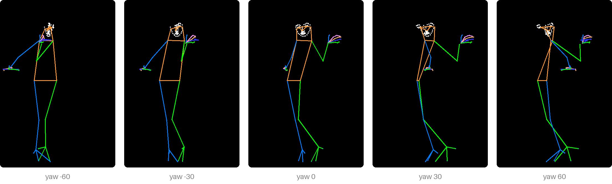

# Getting started

## Install

```sh
pip install poseorbit
pip install "poseorbit[server]"     # with the HTTP server
```

Python 3.10 or newer. No GPU and no torch: detection runs on the CPU with
ONNX Runtime.

## Your first skeleton

```python
from PIL import Image
from poseorbit import Camera, Detector, pose

detector = Detector()
result = pose(detector, Image.open("reference.png"), size=(832, 1216),
              camera=Camera(yaw=-30))
result.skeleton.save("skeleton.png")
```

That finds the people in `reference.png`, takes the most confident one,
turns the camera 30° to the viewer's left, fits the figure onto an
832×1216 canvas and draws it on black:



Give `size` the size you will generate at: the skeleton is drawn at it.

## The first run

The first `pose` (or `detect`) downloads three model files, about 700 MB,
into `~/.cache/poseorbit`, or the `weights_dir` you give
[`Detector`][poseorbit.Detector]. They come from fixed commits on Hugging
Face, are Apache-2.0 like poseorbit, and each is checked against its SHA-256
before it is used; nothing is left in Hugging Face's own cache. After that,
nothing goes over the network.

Loading takes a few seconds, so make one `Detector` and reuse it: it is safe
to share between threads. Detecting one person then takes about 0.7 s on a
desktop CPU.

## What comes back

[`pose`][poseorbit.pose] returns a [`PoseResult`][poseorbit.PoseResult]:

| Field | What it is |
|---|---|
| `skeleton` | The drawing, a PIL image at `size`, on black |
| `people` | Everyone found, left to right, as detected |
| `person` | Whom it drew: an index, a sorted list, or `-1` for everyone |
| `camera`, `framing` | The camera and framing it used, after clamping |
| `joints_in_frame` | Body joints (of 17) left inside the canvas |

## Next

Each page takes one step of `pose` on its own:

- [Choose people](people.md): who is found, in what order, and how to pick.
- [Turn and frame](turn-and-frame.md): the camera, the zoom, and their limits.
- [Move joints](move-joints.md): raise an arm, bend a knee.
- [Use with an image model](with-a-model.md): the skeleton in diffusers, and which style.
- [From another program](from-another-program.md): the command line and the HTTP server.
- [Limits and tips](limits.md): where single-picture 3D runs out, and what helps.
