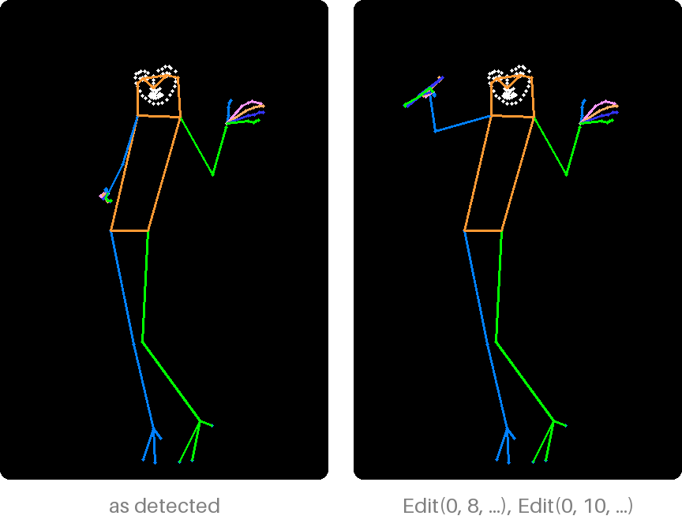

# Move joints

```python
from poseorbit import Edit

right_elbow, right_wrist = 8, 10
figure = detector.detect(picture, depth=True)[0].points_3d
x, y, z = figure[right_elbow]
result = pose(detector, picture, size=(832, 1216), person=0,
              edits=[Edit(0, right_elbow, (x - 60, y - 40, z)),
                     Edit(0, right_wrist, (x - 70, y - 160, z))])
```



An [`Edit`][poseorbit.Edit] turns one joint about its parent until it points
at `to` (x, y and depth in the picture's pixels, like `Person.points_3d`).
Everything hanging from it turns too, and no bone changes length: moving an
elbow swings the forearm and the hand. Edits apply in order, each to the pose
the ones before left, so the same list always gives the same pose.

"Left" and "right" are the person's own, as in COCO: the right arm is on the
viewer's left in a front view.

## Which joints move

These joints move (`MOVABLE`):

| Joint | Turns about | Carries |
|---|---|---|
| Nose (0) | The middle of the shoulders | Eyes, ears and face |
| Shoulders (5, 6) | The hip on its side | The whole arm and hand |
| Elbows (7, 8), wrists (9, 10) | The shoulder, the elbow | The rest of the arm and the hand |
| Knees (13, 14), ankles (15, 16) | The hip, the knee | The rest of the leg and the foot |
| Toes and heels (17–22) | The ankle | Nothing |

The hips are the root and stay put; turn the whole figure with the
[camera](turn-and-frame.md). Moving a shoulder leaves the head where it is.
Fingers do not move one by one: a hand keeps its shape. `poseorbit.body`
holds the keypoint names (`NAMES`) and their tree.

Edits need depth, so `pose` detects it whenever there are any.
`PoseResult.people` stays as detected; the edits only change what is drawn.

## On points of your own

[`bend`][poseorbit.bend] moves one joint of a `(133, 3)` array, and
[`apply_edits`][poseorbit.apply_edits] applies a list of edits to several
people's arrays, the same way `pose` does.
