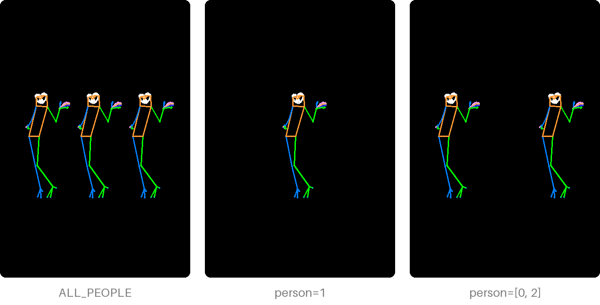

# Choose people

## Who is found

```python
from PIL import Image
from poseorbit import Detector

detector = Detector()
picture = Image.open("group.png")

people = detector.detect(picture)           # left to right
for index, person in enumerate(people):
    print(index, person.bbox, person.visible)
```

Each [`Person`][poseorbit.Person] has 133 COCO-WholeBody keypoints (body,
feet, face and hands) in the picture's pixels, their scores, a `bbox` around
what would be drawn, and `visible`, the number of body joints (of 17) seen.

People come back **left to right by the centre of the figure**, so the same
picture numbers its people the same way every time: index 1 is the same
person on every call.

A detection with fewer than 8 of 17 body joints seen is not offered as a
person (a blank canvas otherwise "finds" one). With nobody left, `detect`
raises [`NoPersonError`][poseorbit.NoPersonError].

Pass `depth=True` to also get each keypoint's depth (`Person.depth`, in the
same pixels as x and y, positive away from the viewer). It costs about 0.3 s
more; `pose` asks for it only when it needs it (a turn or an edit).

## Whose pose to draw

```python
from poseorbit import ALL_PEOPLE, pose

pose(detector, picture, size=(832, 1216), person=ALL_PEOPLE)   # everyone (-1)
pose(detector, picture, size=(832, 1216), person=1)            # the second from the left
pose(detector, picture, size=(832, 1216), person=[0, 2])       # those two
pose(detector, picture, size=(832, 1216))                      # the most confident
```



A person is drawn where they stand in the picture, letterboxed onto the
output. So a list keeps the gaps between the people it names, and a small
figure gives a small skeleton: zoom in on them with
[framing](turn-and-frame.md#frame-it).

A list draws its people in left-to-right order whatever order it is given
in, and `result.person` is that sorted list. An empty list, or an index past
the end, raises `ValueError`.

Drawn together, people turn around one shared centre (the middle of their
hips), so a group keeps its layout when the camera moves.
