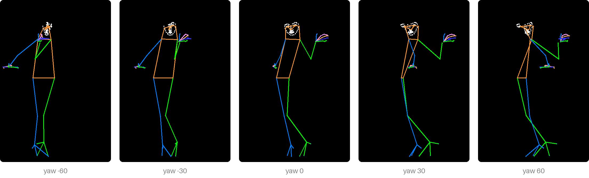
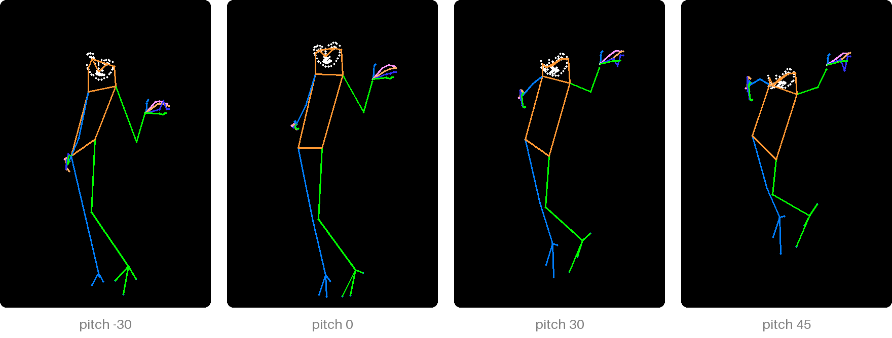
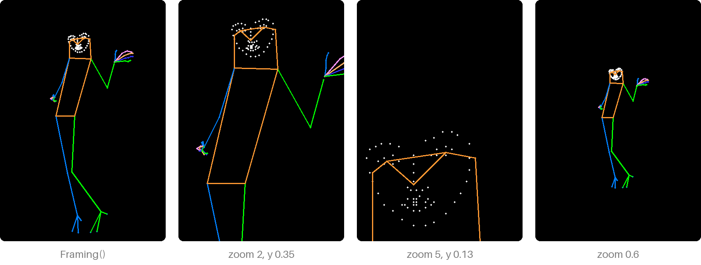

# Turn and frame

## Turn it

```python
from poseorbit import Camera

result = pose(detector, picture, size=(832, 1216), camera=Camera(yaw=-30, pitch=10))
```

[`Camera`][poseorbit.Camera] orbits the figure. `yaw` swings it to the
viewer's right (negative: left):



and `pitch` raises it, to look down on the figure (negative: up at it):



The camera is orthographic, so turning never makes the figure bigger or
smaller, and the front view (`Camera()`) is exactly the detected pose.

Angles are held to **±90° yaw and ±45° pitch** (`MAX_YAW`, `MAX_PITCH`);
anything past them is clamped, and `result.camera` says what was used.
Depth comes from a single picture, and past a side view which limb is in
front gets unreliable. See [Limits and tips](limits.md#turning) for what
helps when a model draws the figure from behind.

## Frame it

```python
from poseorbit import Framing

# The face of a full-body picture: centre on it and zoom five times.
result = pose(detector, picture, size=(832, 1216),
              framing=Framing(zoom=5, x=0.5, y=0.13))
print(result.joints_in_frame)   # body joints still inside the canvas
```

[`Framing`][poseorbit.Framing] crops the output canvas like a photo: the
canvas point (`x`, `y`, as fractions of its width and height) moves to the
middle and everything scales by `zoom`, from 0.5 to 6. Below 1 it pulls
back, leaving room around the figure.



Framing comes after the turn and never moves the point the camera orbits, so
the two can be set separately.

`joints_in_frame` tells how much of the body is left. A body-only skeleton
(the [`openpose` style](styles.md)) keeps few points in a close-up; the
`dwpose` style also draws the face and hands, which a close-up still has.

The exact mapping, for a viewer that must show the same thing, is in
[Coordinates](coordinates.md).
