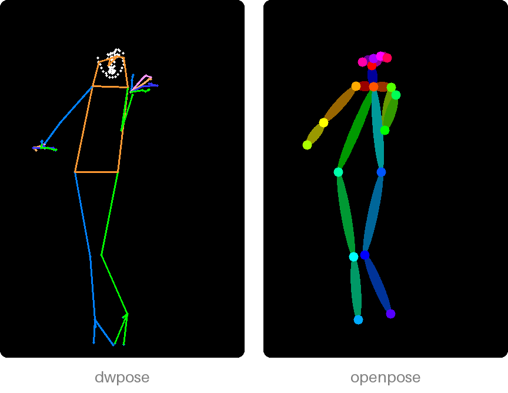

# Use with an image model

poseorbit draws the skeleton; a pose-conditioned model (a ControlNet, or an
adapter trained on pose drawings) turns it into a picture. The prompt sets
everything else: who, what they wear, the style.

## Which style

A model follows the kind of drawing it was trained on, so pick the style to
match it:



- `dwpose` (the default) for DWPose-trained adapters: body, feet, hands and
  face in thin lines.
- `openpose` for OpenPose ControlNets, such as
  `xinsir/controlnet-openpose-sdxl-1.0`: the body only, in thick limbs.

[Skeleton styles](styles.md) has the details and how well each was followed.

## With diffusers

```python
import torch
from diffusers import ControlNetModel, StableDiffusionXLControlNetPipeline
from PIL import Image
from poseorbit import Camera, Detector, pose

controlnet = ControlNetModel.from_pretrained(
    "xinsir/controlnet-openpose-sdxl-1.0", torch_dtype=torch.float16)
pipe = StableDiffusionXLControlNetPipeline.from_pretrained(
    "stabilityai/stable-diffusion-xl-base-1.0", controlnet=controlnet,
    torch_dtype=torch.float16).to("cuda")

detector = Detector()
skeleton = pose(detector, Image.open("reference.png"), size=(832, 1216),
                camera=Camera(yaw=45), style="openpose").skeleton
image = pipe("a person walking, full body", image=skeleton,
             width=832, height=1216).images[0]
```

The skeleton must be drawn at the size you generate at, as here. poseorbit
itself needs no GPU; only the image model does.

## In other tools

Any tool that takes a pose image as a control input can use the PNG:
save `result.skeleton` and load it where the tool asks for a ControlNet or
pose image, with its preprocessor off (the picture is already a skeleton).
To call poseorbit from a tool written in another language, run its
[HTTP server](from-another-program.md).

## Prompting

- Say how much of the figure shows to match the framing: "full body",
  "upper body", "portrait, close-up".
- For a strongly turned figure, see
  [front or back](limits.md#turning).
